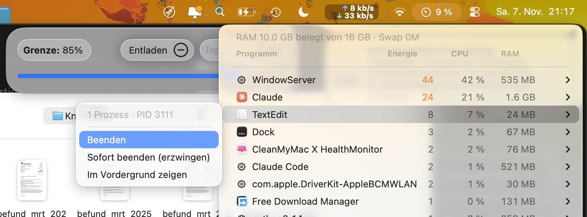

# Verbrauch

Menüleisten-App für macOS (ab 13): zeigt, welche Programme gerade Energie, CPU und RAM
verbrauchen – gruppiert nach Programm inklusive aller Helfer-Prozesse – und beendet sie auf Wunsch
direkt aus dem Menü (normal oder erzwungen). Ergänzt das Apple-Batteriemenü, das nur
„Erheblicher Energieverbrauch“ ohne Zahlen anzeigt.

- Energie-Spalte = Energieeinfluss wie in der Aktivitätsanzeige (`top`-Spalte POWER)
- Sortierung nach Energie oder CPU, Autostart per Anmeldeobjekt
- Systemprozesse anderer Benutzer werden angezeigt, aber nicht beendbar

Bauen und installieren: `./build.sh` (Ergebnis in `dist/Verbrauch.app`, wird nach `/Applications` kopiert).
